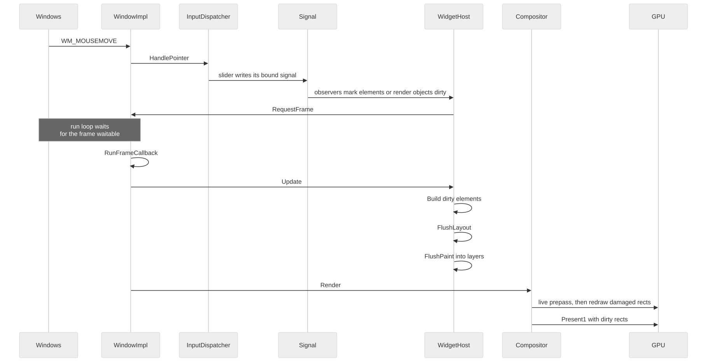

# Architecture

This page explains what happens between a widget struct and pixels on screen. You don't need it to use XenUI, but it
explains why the rules in the other pages exist.

## The big picture

Work moves through five stages, each owned by a different part of the code:

| Stage | Code | Responsibility |
|---|---|---|
| Widgets and signals | Your code, `Tree/`, `Reactive/` | Describe the interface and hold state |
| Elements | `Tree/` | Identity, state and reconciliation: decide what changed |
| Render objects | `Render/` | Layout, hit testing and painting into display lists |
| Layers | `Graphics/` | Retained display lists, live content, transforms and clips |
| Compositor | `Graphics/` | Damage tracking, caching and drawing to the swap chain |

Each stage only does work for the parts of the interface that changed.

## The run loop

`App::Run` waits for window messages, timers and frame deadlines. When nothing is pending it sleeps, so an idle
window uses close to no CPU. Input is handled as soon as its message arrives, but drawing waits for the next frame,
so several changes in a row are rendered once.

## One frame

A frame runs in this order:

1. **Rebuild** the elements marked dirty, parents first. A parent's rebuild can update a dirty child before that
   child would rebuild on its own.
2. **Lay out** the render objects that need it, starting from the shallowest relayout boundary.
3. **Paint** the dirty repaint boundaries into their layers' display lists.
4. **Composite** the layer tree, drawing only the damaged region, and present.

## Widgets, nodes and elements

Widget descriptions live in a bump allocator: creating one is a pointer increment, and a block is recycled once
everything in it is released. Most widgets die together when their subtree rebuilds, so this behaves like a frame
arena. Copying a `Node` only bumps a reference count, and a typical build allocates almost nothing from the heap.

Each widget produces an **element**, the long-lived object that holds identity and state. Components (stateless and
stateful widgets) build more widgets. Render widgets own a **render object**. The element tree is the "virtual DOM";
the render tree is what is laid out and drawn.

## Reconciliation

When a component rebuilds, each new child is matched to an existing element by position, type and key:

- **A matching element is updated in place.** Its state survives, and its render object is reconfigured.
- **A non-matching element is replaced,** and its whole subtree with it.
- **An identical node is skipped entirely.** If a component returns the exact same `Node` as last time, nothing
  below it is visited, which is why caching nodes pays off.

## Signals and rebuilds

Every tracked read records a dependency between a signal and an observer. When the signal changes, each observer
reacts in the cheapest way it can:

- **A component rebuilds.**
- **A bound control or `CustomPaint` repaints,** with no rebuild.
- **A split view relays out.**
- **An `Effect` runs again,** after the current batch.

## Layout

Constraints go down, sizes come up and parents place children. A render box is a **relayout boundary** when its
constraints are tight, or when its parent doesn't depend on its size; a change inside it then lays out only that
subtree.

## Painting and layers

Render objects paint into Direct2D display lists, grouped into layers at **repaint boundaries**. A layer that didn't
change reuses its recording. Moving a layer only changes its offset: a moving playhead touches one tiny layer, and
the timeline under it is not repainted.

## Compositing and damage

The compositor tracks the damaged region of each frame and draws only the union of recent damage, which keeps every
back buffer of the flip-model swap chain correct. Frames are presented with dirty rectangles, so Windows composes
just the changed area too.

## Live rendering

`LiveView` bypasses the display lists. Its callback records primitives into instanced Direct3D 11 batches every
frame, between the retained layers below and above it. Data from other threads arrives through `TripleBuffer` and
`SpscQueue`, so the audio thread never waits for the UI.

## Input

A pointer press hit-tests the render tree, deepest first, and captures the path, so a drag keeps reaching its widget
after the pointer leaves it. Gesture detectors on that path compete for taps and drags, and the deepest interested
one wins.

Keys go to the focused widget first and travel outward through its ancestors, then to the window's shortcuts.
Preempting shortcuts run before all of them, except when the key types text into a focused text field.

## Overlays and popups

Each window's root is an overlay host. Popups become separate native windows when the host supports them, so they can
extend past the window edge like real Windows menus. Otherwise they fall back to layers in the overlay, with the same
behavior.

## Source layout

| Directory | Contents |
|---|---|
| `Core/` | Math, colors, timers, animation, lock-free helpers |
| `Reactive/` | Signals, computed values, effects |
| `Tree/` | Nodes, the widget concepts, elements, components, keys, `Provide` |
| `Layout/` | Constraints, insets, alignment |
| `Render/` | Render objects, semantics |
| `Graphics/` | Device, swap chain, painter, display lists, layers, compositor, text, images, live rendering |
| `Input/` | Events, the input dispatcher, focus, shortcuts, text editing, drag and drop |
| `Platform/` | Windows, popups, clipboard, OLE drag and drop, UI Automation |
| `Widgets/` | Every widget, the theme and `WidgetHost` |

The diagrams on this page are generated from Mermaid sources in `Docs/Images/Source`.
