# Input

## Pointer input

Three widgets receive the mouse, from lowest to highest level:

| Widget | Receives |
|---|---|
| `Listener` | Raw `OnDown`, `OnMove`, `OnUp`, `OnCancel` and `OnWheel` events |
| `MouseRegion` | `OnEnter`, `OnExit` and `OnHover`, and sets the `Cursor` shown over it |
| `GestureDetector` | Taps, double taps, right-clicks (`OnSecondaryTap`) and drags |

```cpp
MouseRegion {
  .OnEnter = [this](const PointerEvent&) { _Hovered = true; },
  .OnExit  = [this](const PointerEvent&) { _Hovered = false; },
  .Cursor  = CursorShape::Hand,
  .Child =
    GestureDetector {
      .OnTap       = [this](const TapEvent&) { Select(); },
      .OnDoubleTap = [this](const TapEvent&) { Open(); },
      .Child       = Row,
    },
}
```

Event positions are in DIPs. `PointerEvent::Position` is in window space and `LocalPosition` is relative to the
widget that receives it. A pointer that goes down on a widget keeps sending it events until it is released, even
after leaving its bounds.



### What gets hit

Each of these widgets has a `Behavior`:

- `HitTestBehavior::DeferToChild` (the default) is hit only where one of its children draws something. An empty
  area of a row with a gesture detector is not clickable.
- `Opaque` is hit anywhere inside its bounds and hides what is behind it. Use it for clickable rows and cards.
- `Translucent` is hit anywhere inside its bounds and lets what is behind it be hit too.

### Taps versus drags

When several gesture detectors are under the pointer, the **deepest one interested in the gesture wins**. Moving past
the drag threshold hands the pointer to the deepest detector that handles drags; releasing without moving hands it
to the deepest one that handles taps. A clip inside a draggable timeline can therefore be clicked and dragged on its
own, while empty timeline space still drags the timeline.

`DragEvent` reports `Delta` since the last update and `TotalDelta` since the start. Set `RelativeDrag = true` for
knobs and faders: the cursor hides and movement is not stopped by the screen edges.

## Focus and keyboard input

Keyboard input goes to the focused widget. `Focus` makes its child focusable:

```cpp
Focus {
  .OnKey =
    [this](const KeyEvent& Event) {
        if (!Event.Pressed || Event.Code != KeyCode::Delete) { return false; }
        DeleteSelection();
        return true;
    },
  .Child = Content,
}
```

- **`OnKey` returns whether it handled the key.** Unhandled keys travel outward through the enclosing `Focus` and
  `Shortcuts` widgets, then to the window's shortcuts.
- **Tab and Shift+Tab move focus** between focusable widgets in paint order.
- **Clicking focuses** a `Focus` widget unless `FocusOnTap = false`. `AutoFocus = true` focuses it when it appears,
  and `CanRequestFocus = false` makes it skip focus altogether.

To read or move focus from code, own a `FocusNode` in your state and pass it as `Target`:

```cpp
FocusNode _SearchFocus;
...
Focus {.Target = &_SearchFocus, .Child = ...}
...
_SearchFocus.RequestFocus();        // focus it now, or as soon as it is on screen
bool Focused = _SearchFocus.HasFocus(); // tracked, so reading it in Build rebuilds on change
```



## Shortcuts

Key combinations are written as `KeyModifiers::Control + KeyCode::S`. Several keys in a row make a chord:

```cpp
MainWindow.SetShortcuts({
  {{KeyModifiers::Control + KeyCode::S}, [&Model] { Model.Save(); }},
  {{KeyModifiers::Control + KeyCode::K, KeyModifiers::Control + KeyCode::C}, [&Model] { Model.CommentLine(); }},
  {.Keys = {KeyCombination {KeyCode::Space}}, .Action = [&Model] { Model.TogglePlay(); }, .Preempts = true},
});
```

- `Window::SetShortcuts` applies everywhere in the window, after focused widgets decline the key.
- The `Shortcuts` widget (`Shortcuts {.Bindings = {...}, .Child = ...}`) applies only while focus is inside its child.
- **`Preempts = true` runs the shortcut before the focused widget sees the key.** A focused button therefore can't
  steal Space from a transport. Keys that type text still go to a focused text field, so you can type spaces.
- Chord steps must follow each other within 1.5 seconds.

## Text input

`TextField` is a single-line editor with selection, word movement (Ctrl+arrows), undo and redo, clipboard
shortcuts and IME composition. See [Controls](Controls.md#text-fields). For direct control of its contents, own a
`TextEditingController`:

```cpp
TextEditingController _Editor;
...
TextField {.Controller = &_Editor}
...
_Editor.SetText("Untitled");
const std::string& Current = _Editor.GetText(); // tracked
```

While a text field has focus it consumes printable keys, so shortcuts made of plain letters don't fire while
typing.

## Clipboard

```cpp
Clipboard::SetText("Hello");
if (std::optional<std::string> Pasted = Clipboard::GetText()) { ... }

// Custom formats carry raw bytes under a name, plus optional text for other applications.
Clipboard::SetData("Xen.Clip", Bytes, "Kick drum clip");
std::optional<std::vector<uint8_t>> Data = Clipboard::GetData("Xen.Clip");
```

Text is UTF-8 with `\n` line endings. Clipboard calls must be made on the UI thread.

## Drag and drop

`DragSource` starts a drag when the pointer moves past the drag threshold; `DropTarget` receives it:

```cpp
DragSource {
  .Data     = [Index] { return std::optional<DragData>(DragData {.Value = SampleDrag {Index}, .Text = "Kick.wav"}); },
  .Allowed  = DropEffect::Copy,
  .Feedback = Text {.Content = "Kick.wav"},
  .Child    = Row,
}

DropTarget {
  .OnOver =
    [](const DropEvent& Event) { return Event.Data->Get<SampleDrag>() != nullptr ? DropEffect::Copy : DropEffect::None; },
  .OnDrop = [this](const DropEvent& Event) { Insert(*Event.Data->Get<SampleDrag>(), Event.LocalPosition); },
  .Child  = Lane,
}
```

- **Inside the application**, `DragData::Value` (a `std::any`) carries any C++ value. Read it with `Get<T>()`.
- **Between applications**, drags go through Windows (OLE) drag and drop:
  - Dragging out of the window hands the drag to the system with `Files` and `Text`, so files can be dropped into
    Explorer or another program.
  - Files and text dragged in from other programs arrive with `External = true` and an empty `Value`.
- **`OnOver` decides whether a drop is accepted**, and with which effect. It is called as the pointer moves. Return
  `DropEffect::None` to refuse the drop.
