# Layout

## Constraints go down, sizes come up

Layout follows one rule. A parent gives each child **constraints**: a minimum and maximum width and height. The
child picks a size within them, and the parent then positions it. A widget never sets its own position.



Two consequences explain most surprises:

- **"Tight" constraints (minimum equals maximum) leave the child no choice.** The window gives the root widget tight
  constraints, so the root always fills the window.
- **Many widgets fill the space they're offered.** `Align`, `Center`, an `Expanded` child and a `Column` (along its
  main axis) all do. To make something take only the space it needs, put it where the constraints are loose, or use
  the sizing widgets below.

Sizes are in device-independent pixels; XenUI scales to the monitor's DPI for you.

## Rows and columns

`Row` lays children out horizontally and `Column` vertically. (`Flex` is the general form, with a `Direction`.)

```cpp
Row {
  .Spacing        = 8.0f,
  .MainAlignment  = MainAxisAlignment::SpaceBetween,
  .CrossAlignment = CrossAxisAlignment::Center,
  .Children       = {Text {.Content = "Left"}, Text {.Content = "Right"}},
}
```

| Field | Meaning |
|---|---|
| `Spacing` | Gap between children along the main axis |
| `MainAlignment` | Where children go along the main axis: `Start`, `End`, `Center`, `SpaceBetween`, `SpaceAround`, `SpaceEvenly` |
| `CrossAlignment` | Where children go across: `Start`, `End`, `Center`, or `Stretch` to make them fill it |
| `MainSize` | `Max` (default) fills the main axis; `Min` shrinks to fit the children |

`CrossAxisAlignment::Stretch` is the usual way to make a column's children as wide as the column, which is how a
form's fields and buttons follow the window size.

### Sharing space: Expanded and Flexible

Children of a row or column take their natural size unless wrapped in `Expanded` or `Flexible`, which share the
space left over in proportion to `Flex`:

```cpp
Row {
  .Spacing  = 8.0f,
  .Children = {
    Expanded {.Child = TextField {.Placeholder = "Search"}},      // takes all the free space
    Button {.Label = "Go"},                                     // keeps its natural width
  },
}

Row {.Children = {Expanded {.Flex = 2, .Child = Left}, Expanded {.Flex = 1, .Child = Right}}} // 2:1 split
```

`Expanded` forces the child to fill its share. `Flexible` lets it be smaller (`FlexFit::Loose`, the default) or forces
it (`FlexFit::Tight`). `Spacer {}` is an empty `Expanded`, handy for pushing things apart.

A child of a row or column that can grow without limit, such as a `ListView`, must be in an `Expanded`, or it has no
bounded size to fill along the main axis.

## Padding, alignment and sizing

| Widget | What it does |
|---|---|
| `Padding {.Insets, .Child}` | Insets the child. `EdgeInsets::All(8)`, `EdgeInsets::Symmetric(12, 4)`, or `{.Left = 8, .Top = 4}` |
| `Center {.Child}` | Centers the child and fills the available space |
| `Align {.Position, .Child, .WidthFactor, .HeightFactor}` | Places the child at an `Alignment` such as `Alignment::TopRight()`. Fills the space unless a factor is set, in which case its size is the child's size times the factor |
| `SizedBox {.Width, .Height, .Child}` | Forces a size on either axis; also a fixed gap when it has no child |
| `ConstrainedBox {.Limits, .Child}` | Adds extra constraints, such as `{.MaxWidth = 300}` |
| `Container {...}` | Convenience for the common mix: size, margin, padding, background, corner radius, border and child alignment |

```cpp
Container {
  .Padding      = EdgeInsets::All(12.0f),
  .Background   = Style.Surface,
  .CornerRadius = 8.0f,
  .BorderColor  = Style.Border,
  .Child        = Text {.Content = "A card"},
}
```

`Align {.Child = Content, .WidthFactor = 1.0f}` is the way to center something vertically while keeping its natural
width. The built-in `Button` uses it so it doesn't stretch inside a column.

## Wrap and grids

`Wrap` flows children left to right and starts a new run below whenever the next child would not fit, like words in
a paragraph. Use it for tag lists and toolbars that should reflow:

```cpp
Wrap {.Spacing = 8.0f, .RunSpacing = 8.0f, .Children = std::move(Tags)}
```

`Alignment` places each run (`Start`, `Center`, `End` or `SpaceBetween`), and `CrossAlignment` aligns children of
different heights within a run.

`Grid` lays children out in equal-width columns, filling rows left to right:

```cpp
Grid {.MinColumnWidth = 120.0f, .Spacing = 8.0f, .RunSpacing = 8.0f, .RowHeight = 56.0f, .Children = std::move(Tiles)}
Grid {.Columns = 3, .Spacing = 12.0f, .Children = std::move(Cards)}
```

- With `Columns = 0` (the default), the grid fits as many columns of at least `MinColumnWidth` as the width allows,
  so it reflows as its container resizes. A positive `Columns` fixes the count.
- Every cell is exactly one column wide. Each row is as tall as its tallest child, or exactly `RowHeight` when set.

## Stacking

`Stack` draws its children on top of each other. Children wrapped in `Positioned` are placed by their edges or size;
the others are aligned with `DefaultAlignment`:

```cpp
Stack {
  .Fit      = StackFit::Expand,
  .Children = {
    Image,
    Positioned {.Right = 8.0f, .Bottom = 8.0f, .Child = Badge},
  },
}
```

`StackFit::Expand` makes non-positioned children fill the stack; `Loose` (the default) lets them take their natural
size.

## Scrolling

```cpp
ScrollView {.Child = Column {.Children = std::move(Rows)}}
ListView {.ItemCount = 50000, .ItemExtent = 24.0f, .ItemBuilder = [this](int Index) { return Row(Index); }}
```

- `ScrollView` scrolls one child of any size, vertically by default (`Direction = Axis::Horizontal` for sideways).
- `ListView` is virtualized: it only builds the rows that are visible, so it handles very long lists. Every row has
  the same height, `ItemExtent`.
- Both accept a `ScrollController*` to read or set the position (`SetOffset`, `ScrollBy`, `EnsureVisible`, and the
  tracked `GetOffset()`). The scrollbar is themed and can be hidden with `ShowScrollbar = false`.
- Vertical views scroll with the mouse wheel; horizontal ones with a horizontal wheel or Shift and the wheel, so the
  two can be nested.

`ClipRect` clips its child to its bounds without scrolling.

## Images and text

```cpp
ImageView {.Source = Image::FromFile("Assets/logo.png"), .Fit = ImageFit::Contain, .Width = 64.0f}
Text {.Content = "Title", .Font = Font {.Size = 18.0f, .Weight = FontWeight::SemiBold}}
```

`Text` takes its font and color from the nearest `Provide<TextStyle>` unless you set them. It wraps by default; set
`Wrapping = TextWrapping::NoWrap` and `Trimming = TextTrimming::Ellipsis` for single-line labels that end in "…"
when there is no room.

## Custom painting

`CustomPaint` gives you a `Painter` in local coordinates, sized by its child or by `Width` and `Height`:

```cpp
CustomPaint {
  .OnPaint =
    [Level = Meter.Get()](Painter& Canvas, const Size& Extent) {
        Canvas.FillRect({0.0f, 0.0f, Extent.Width, Extent.Height}, Color::FromHex(0x15151A));
        Canvas.FillRect({0.0f, Extent.Height * (1.0f - Level), Extent.Width, Extent.Height * Level},
                        Color::FromHex(0x4DA3FF));
    },
  .Width  = 12.0f,
  .Height = 120.0f,
}
```

The painter draws rectangles, rounded rectangles, ellipses and circles, lines, paths (`PathBuilder`), text layouts
and images, with solid colors or `LinearGradient` and `RadialGradient` brushes, and supports transforms, clips and
opacity. What you paint is recorded once and reused until it changes, so painting is cheap.

Signals read inside `OnPaint` are tracked: when they change, only this widget repaints, with no rebuild. Use that for
values that change quickly, and capture the value instead, as above, when a rebuild is fine.

For content that changes every frame, such as meters fed by an audio thread, use a `LiveView` instead (see
[Live rendering](LiveRendering.md)).

## Repaint boundaries

`RepaintBoundary {.Child}` gives its child its own layer, so repainting the child doesn't repaint its surroundings,
and vice versa. Wrap regions that repaint often and independently, such as a playhead or a meter. `ScrollView` adds
one around its content for you.
