# Live rendering

Most of an interface changes occasionally, and XenUI's retained rendering repaints only those changes. Some content
changes every frame: level meters, oscilloscopes, waveforms while recording, spectrograms. For those, `LiveView`
offers an immediate-mode canvas that is redrawn every frame with instanced Direct3D 11 draws. Tens of thousands of
line segments per frame are practical.

## LiveView

```cpp
LiveView {
  .OnDraw =
    [this](LiveCanvas& Canvas) {
        const Size Extent = Canvas.GetSize();
        Canvas.FillRect({0.0f, 0.0f, Extent.Width, Extent.Height}, Color::FromHex(0x111115));
        Canvas.DrawPolyline(_Scope, 1.5f, Color::FromHex(0x4DA3FF));
    },
  .Continuous = true,
  .Height     = 120.0f,
}
```

- `OnDraw` records primitives in local coordinates, in DIPs. Recording is cheap: everything in one callback becomes a
  handful of draw calls, regardless of how many primitives it holds.
- With `Continuous = true` the view redraws every frame while it is on screen. Use it for data read from another
  thread.
- Without it, the view redraws only when a signal read inside `OnDraw` changes.
- `Width` and `Height` set its preferred size; otherwise it fills the space it is given.

## LiveCanvas

| Call | Draws |
|---|---|
| `FillRect(Bounds, Color)` | A solid rectangle |
| `DrawLine(Start, End, Width, Color)` | A line segment |
| `DrawPolyline(Points, Width, Color)` | Connected segments with round joins, one primitive per segment |
| `FillColumns(Left, ColumnWidth, Baseline, Tops, Color)` | Vertical bars from a baseline, one per value, for spectra and waveforms |
| `DrawTexture(Texture, Destination, SourceOffset, Opacity)` | A `LiveTexture`, optionally scrolled horizontally |

`GetSize()` returns the view's size.

## LiveTexture

`LiveTexture` is a CPU-side BGRA image that is streamed to the GPU when drawn. It suits spectrograms and similar
content that is rewritten continuously. Write one column at a time into a ring and advance `SourceOffset` to scroll
it:

```cpp
_Spectrogram.WriteColumn(_Column, Pixels);              // one column of premultiplied BGRA pixels, top to bottom
_Column = (_Column + 1) % _Spectrogram.GetWidth();
Canvas.DrawTexture(_Spectrogram, Bounds, static_cast<float>(_Column) / _Spectrogram.GetWidth());
```

## Threads

`LiveView` is drawn on the UI thread, but its data usually comes from somewhere else, such as an audio callback.
`Core/Concurrent.hpp` provides two lock-free helpers that never make either side wait.

### TripleBuffer: the latest snapshot

Use it when only the newest value matters, as with meter levels or a scope frame:

```cpp
TripleBuffer<MeterLevels> Meters;

// Audio thread
Meters.GetWriteSlot() = ComputeLevels(Block);
Meters.Publish();

// UI thread, inside OnDraw
Meters.Acquire();                        // takes the newest published value, if any
const MeterLevels& Levels = Meters.Read();
```

### SpscQueue: every value, in order

Use it when every sample matters, as for a scrolling waveform. It holds one producer and one consumer, its capacity
is a power of two, and its element type is trivially copyable:

```cpp
SpscQueue<float, 8192> Samples;

// Audio thread
Samples.PushRange(Block);                 // pushes what fits and returns how many were pushed

// UI thread, inside OnDraw
while (const std::optional<float> Value = Samples.Pop()) { _History.push_back(*Value); }

// Or drain many at once into a buffer.
std::array<float, 1024> Buffer;
const size_t Count = Samples.PopRange(Buffer);
```

Never touch signals or widgets from another thread. Hand data to the UI through these helpers and write signals on
the UI thread.


