# Widgets

A widget is a small struct that **describes** part of the interface. It holds configuration (a label, a color, a
callback, its children) and nothing else. Building a UI means returning a tree of these descriptions; XenUI keeps
the long-lived objects behind them and updates those objects in place when a new description arrives.

```cpp
Column {
  .Spacing  = 8.0f,
  .Children = {
    Text {.Content = "Volume"},
    Slider {.Bind = &Volume, .Label = "Volume"},
  },
}
```

Widgets are aggregates written with designated initializers. Fields must appear in the order the struct declares
them, and fields you leave out keep their defaults. The headers in `Source/XenUI/Widgets` list every field.

## Nodes

Any widget converts to a `Node`, a cheap, reference-counted handle to an immutable copy of the widget. Children are
stored as `Node Child` or `NodeList Children` (a `std::vector<Node>`), so different widget types mix freely:

```cpp
NodeList Rows;
for (const Track& Item : Tracks) {
    Rows.push_back(TrackRow {.Name = Item.Name});
}
if (ShowFooter) {
    Rows.push_back(Text {.Content = "End of list"});
}
return Column {.Children = std::move(Rows)};
```

An empty `Node {}` means "nothing here"; containers skip empty children.



## The four kinds of widget

XenUI recognizes what a struct is by its shape, using C++20 concepts. There is no base class to inherit from, which
is what lets every widget stay an aggregate with designated initializers.

| Kind | How the struct looks | Use it for |
|---|---|---|
| Stateless | Has `Node Build(BuildContext&) const` | Composing other widgets from its fields |
| Stateful | Has a nested `State` class deriving `ComponentState<T>` | Anything that keeps state between rebuilds |
| Render | Has `CreateRenderObject()` and `UpdateRenderObject()` | Custom layout, painting or hit testing |
| Provide | `Provide<T>` | Making a value available to everything below |

### Stateless widgets

A stateless widget turns its fields into other widgets:

```cpp
struct Labelled {
    std::string Label;
    Node Control;

    Node Build(BuildContext& Context) const {
        (void)Context;
        return Column {
          .Spacing  = 4.0f,
          .Children = {Control, Text {.Content = Label}},
        };
    }
};
```

It rebuilds when its parent supplies a new description, and when a signal it read during `Build` changes.

### Stateful widgets

When a widget needs state that survives rebuilds, such as a hover flag, a text buffer or an animation, put that
state in a nested `State` class:

```cpp
struct Counter {
    std::string Label = "Count";

    class State : public ComponentState<Counter> {
    protected:
        Node Build(BuildContext& Context) override {
            (void)Context;
            return Button {
              .Label     = std::format("{}: {}", GetWidget().Label, _Count()),
              .OnPressed = [this] { _Count = _Count.Peek() + 1; },
            };
        }

    private:
        Signal<int> _Count = 0;
    };
};
```

- **The struct (`Counter`) is the description.** Its parent recreates it on every rebuild, so it must not hold
  state. Read the current one with `GetWidget()`.
- **The `State` object lives as long as the widget stays in the tree** at the same position, with the same type and
  key. Keep signals, controllers, focus nodes, timers and animations here.
- **Reading a signal in `Build` subscribes the component.** Here `_Count()` does that, so pressing the button
  rebuilds it. See [Signals](Signals.md).

`ComponentState` has a few lifecycle hooks:

| Member | When it runs |
|---|---|
| `Init()` | Once, after the widget is mounted and before the first `Build` |
| `Build(BuildContext&)` | Whenever the component needs to describe itself again |
| `WidgetUpdated(const T& Previous)` | After the parent supplied a new description of the same type and key |
| `Dispose()` | Once, when the widget leaves the tree for good |
| `MarkNeedsBuild()` | Call it to rebuild on the next pass; rarely needed, since signals do this for you |

Capturing `this` in callbacks, as above, is safe: callbacks are replaced by the next build, and the state outlives
every description it produced.

### Render widgets

Most interfaces only need composition. When you need your own layout, painting or hit testing, write a render
object and a widget that configures it:

```cpp
class RenderSwatch final : public RenderBox {
public:
    void SetFill(const Color& Fill) {
        if (Fill == _Fill) { return; }
        _Fill = Fill;
        MarkNeedsPaint();
    }

    void Paint(PaintContext& Context) override {
        Context.GetPainter().FillRoundedRect({0.0f, 0.0f, GetSize().Width, GetSize().Height}, 4.0f, _Fill);
    }

protected:
    void PerformLayout() override { SetSize(GetConstraints().Constrain({24.0f, 24.0f})); }

    [[nodiscard]] bool HitTestSelf(const Vec2& Position) const override {
        (void)Position;
        return true;
    }

private:
    Color _Fill;
};

struct Swatch {
    Color Fill;

    [[nodiscard]] std::unique_ptr<RenderSwatch> CreateRenderObject() const {
        auto Result = std::make_unique<RenderSwatch>();
        UpdateRenderObject(*Result);
        return Result;
    }

    void UpdateRenderObject(RenderSwatch& Target) const { Target.SetFill(Fill); }
};
```

- `CreateRenderObject` runs once. `UpdateRenderObject` runs whenever a new description arrives, so setters should
  compare before invalidating.
- Call `MarkNeedsLayout()` when a change affects size, and `MarkNeedsPaint()` when it only affects pixels.
- A render widget with a `Node Child` or `NodeList Children` field gets those children as render children
  automatically.
- For many custom visuals, `CustomPaint` is enough and needs no render object. See [Layout](Layout.md#custom-painting).

## Keys

XenUI matches new children to existing ones by position and type. When items in a list can be reordered, inserted
or removed, give each a key, so its state moves with it:

```cpp
for (const Track& Item : Tracks) {
    Rows.push_back(Keyed(Item.Id, TrackRow {.Name = Item.Name}));
}
```

Integer and string keys both work. Without keys, deleting the first row would hand its state, such as text being
edited or a hover highlight, to the row that moved into its place.

## Providing values to descendants

`Provide<T>` makes a value available to every widget below it, without passing it through each constructor:

```cpp
struct AppInfo {
    std::string Version;
};

MainWindow.SetContent(Provide<AppInfo> {.Value = {.Version = "1.0.0"}, .Child = Shell {}});
```

A descendant looks it up while building:

```cpp
Node Build(BuildContext& Context) const {
    const AppInfo* Info = Context.Find<AppInfo>();
    return Text {.Content = Info != nullptr ? Info->Version : "unknown"};
}
```

- **`Find` returns the nearest provided value of exactly type `T`, or `nullptr`.** Derived types don't match.
- **The widget that called `Find` is rebuilt when the provided value changes.**
- **The pointer is only valid during that `Build`.** Copy what you need into callbacks rather than capturing the
  pointer: `[Version = Info->Version] { ... }`.
- **Provided values are read-only.** For shared state that changes, provide a pointer to a model whose fields are
  signals (`Provide<AppModel*>`). Widgets that read those signals rebuild on their own.

XenUI uses this mechanism itself: `Provide<Theme>` styles the built-in controls (see [Theming](Theming.md)) and
`Provide<TextStyle>` sets the default font and color for `Text`.

## Elements and the three trees

Behind the widget tree are two longer-lived trees. **Elements** hold identity and state and decide what to update;
**render objects** do layout, painting and hit testing. Only elements whose description changed, or whose signals
changed, are rebuilt. [Architecture](Architecture.md) explains how the trees work together.


