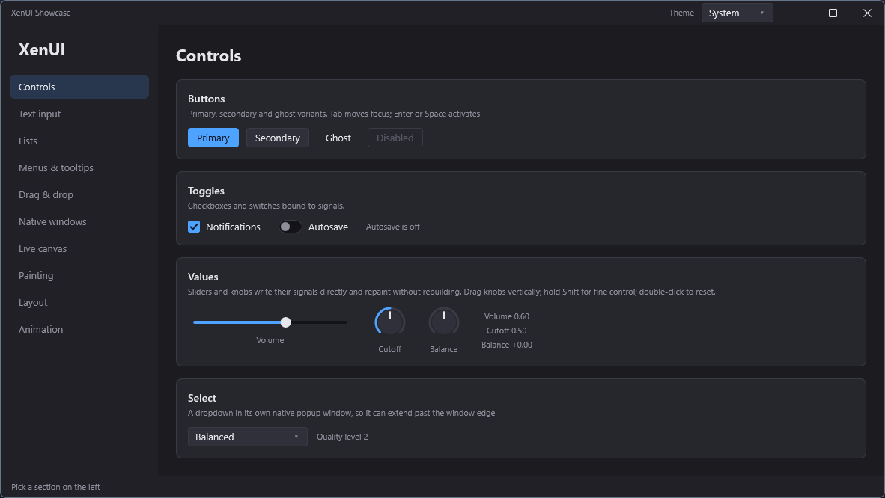

# XenUI

GPU-accelerated Windows GUI framework for C++20 inspired by Flutter. It is the GUI backbone of the Xen Studio DAW.



## Overview

XenUI describes user interfaces as trees of small, immutable widget structs written with designated initializers.
The framework keeps long-lived objects behind that description and updates only what changed:

- **Declarative widgets.** Layout (`Row`, `Column`, `Stack`, `Padding`, ...), controls (`Button`, `Slider`, `Knob`,
  `TextField`, `Select`, menus, tooltips, `ListView`, ...) and your own components compose the same way.
- **Signals.** State lives in `Signal<T>` values. A widget that reads a signal while building is rebuilt when it
  changes; nothing else is.
- **Retained rendering.** Direct2D display lists are cached per layer and composited with damage tracking, so an idle
  window uses almost no CPU and a moving playhead repaints a few pixels.
- **Immediate-mode live content.** `LiveView` draws high-frequency content such as meters, scopes and spectrograms
  with instanced Direct3D 11 every frame, fed from other threads through lock-free helpers.
- **Native Windows behavior.** Per-monitor DPI, custom title bars with Snap Layouts, native popup windows, IME text
  input, OLE drag and drop, the clipboard, embedded native windows (such as plugin editors) and UI Automation for
  screen readers.
- **Minimal dependencies.** XenUI is a single DLL that depends only on the Windows SDK.

XenUI was built for Xen, a digital audio workstation, but contains no audio-specific code.

## Example

A window with a text field and a button that greets whoever typed their name:

```cpp
#include <XenUI/XenUI.hpp>

#include <format>
#include <string>

using namespace XenUI;

struct Greeter {
    class State : public ComponentState<Greeter> {
    protected:
        Node Build(BuildContext& Context) override {
            (void)Context;
            return Padding {
              .Insets = EdgeInsets::All(24.0f),
              .Child =
                Column {
                  .Spacing        = 12.0f,
                  .CrossAlignment = CrossAxisAlignment::Stretch,
                  .Children =
                    {
                      Row {
                        .Spacing = 8.0f,
                        .Children =
                          {
                            Expanded {.Child = TextField {.Bind = &_Name, .Placeholder = "Your name"}},
                            Button {.Label = "Greet", .OnPressed = [this] { Greet(); }, .Variant = ButtonVariant::Primary},
                          },
                      },
                      Text {.Content = _Greeting()},
                    },
                },
            };
        }

    private:
        void Greet() { _Greeting = std::format("Hello, {}", _Name.Peek()); }

        Signal<std::string> _Name;
        Signal<std::string> _Greeting;
    };
};

int main() {
    App HelloApp;

    Window MainWindow({.Title = "Hello, XenUI", .ClientSize = {360.0f, 180.0f}});
    MainWindow.SetOnClosed([&HelloApp] { HelloApp.Quit(); });
    MainWindow.SetContent(Greeter {});
    MainWindow.Show();

    return HelloApp.Run();
}
```

`Greeter` is a stateful widget: the struct is the description its parent creates, and the nested `State` keeps the
two signals alive across rebuilds. Reading `_Greeting()` in `Build` subscribes the component, so pressing the button
rebuilds it. The full version, with a custom title bar, is in [Examples/Hello](Examples/Hello/main.cpp).

## Building

### Requirements

- Windows 10 version 1903 or later, x64
- Visual Studio 2022 or later with the **Desktop development with C++** workload (MSVC and the Windows SDK)
- CMake 3.26 or later and Ninja (both ship with Visual Studio)

### Build steps

Run these from an **x64 Developer Command Prompt for VS**, or any shell where `vcvars64.bat` has been run:

```bash
cmake --preset debug
cmake --build --preset debug
```

Use the `release` preset for an optimized build (`RelWithDebInfo`). Output goes to `build/<preset>/bin`: the DLL
(`XenUId.dll` in Debug, `XenUI.dll` otherwise), the showcase, the examples and the tests.

Run the tests:

```bash
ctest --test-dir build/debug --output-on-failure
```

### Options

| Option                 | Default                    | Description                                             |
|------------------------|----------------------------|---------------------------------------------------------|
| `XENUI_BUILD_TESTS`    | `ON`                       | Build the unit tests (fetches doctest when configuring) |
| `XENUI_BUILD_SHOWCASE` | `ON`                       | Build `XenUIShowcase`, a tour of every widget           |
| `XENUI_BUILD_EXAMPLES` | `ON`                       | Build the small examples in `Examples/`                 |
| `XENUI_INSTALL`        | `ON` when built on its own | Generate install rules and the CMake package            |

For example: `cmake --preset release -DXENUI_BUILD_TESTS=OFF`.

### Using XenUI in your project

Install it once, Debug and Release side by side:

```bash
cmake --install build/debug --prefix C:/Libraries/XenUI
cmake --install build/release --prefix C:/Libraries/XenUI
```

Then find it from your project's `CMakeLists.txt`, configuring with `-DCMAKE_PREFIX_PATH=C:/Libraries/XenUI`:

```cmake
find_package(XenUI 0.1 CONFIG REQUIRED)
target_link_libraries(MyApp PRIVATE XenUI::XenUI)
```

You can also add the repository with `add_subdirectory` or `FetchContent` and link the same `XenUI::XenUI` target.
[Getting started](Docs/GettingStarted.md) covers both, and copying the DLL next to your executable.

## Documentation

- [Guide](Docs/Index.md): getting started, widgets, signals, layout, input, controls, theming, animation, windows,
  live rendering, accessibility and architecture.
- API reference: generated with Doxygen. Run `doxygen` in the repository root to write it to `Docs/html`. If you have
  Python installed, you can quickly host it with this command:

```
cd Docs/html
python -m http.server # defaults to port 8000
```

## License

XenUI is licensed under the [Apache License 2.0](LICENSE).
